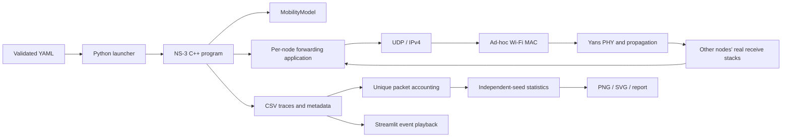
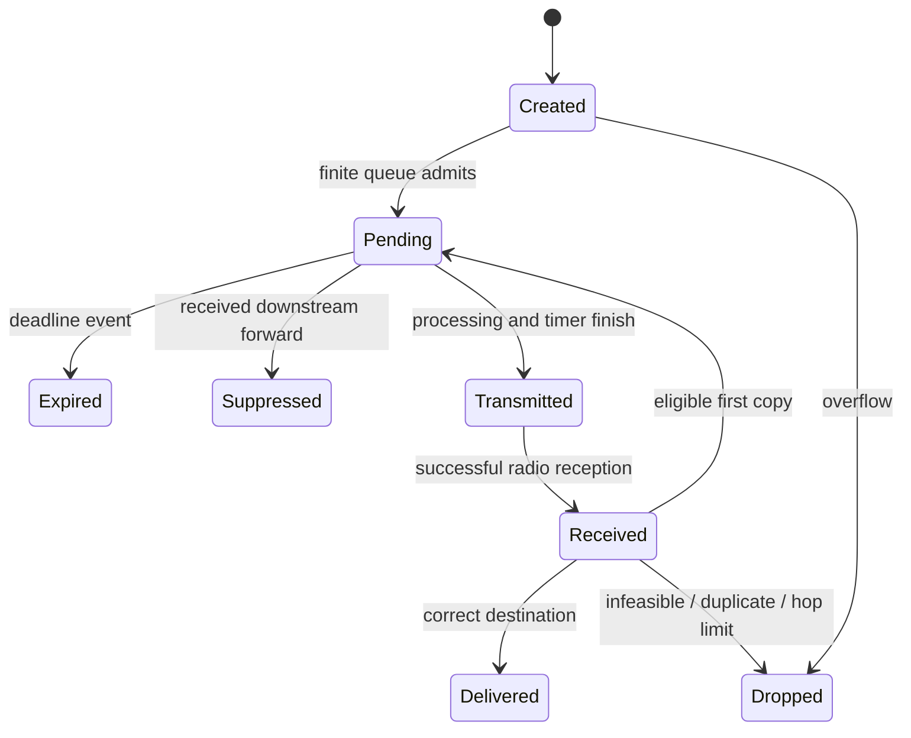
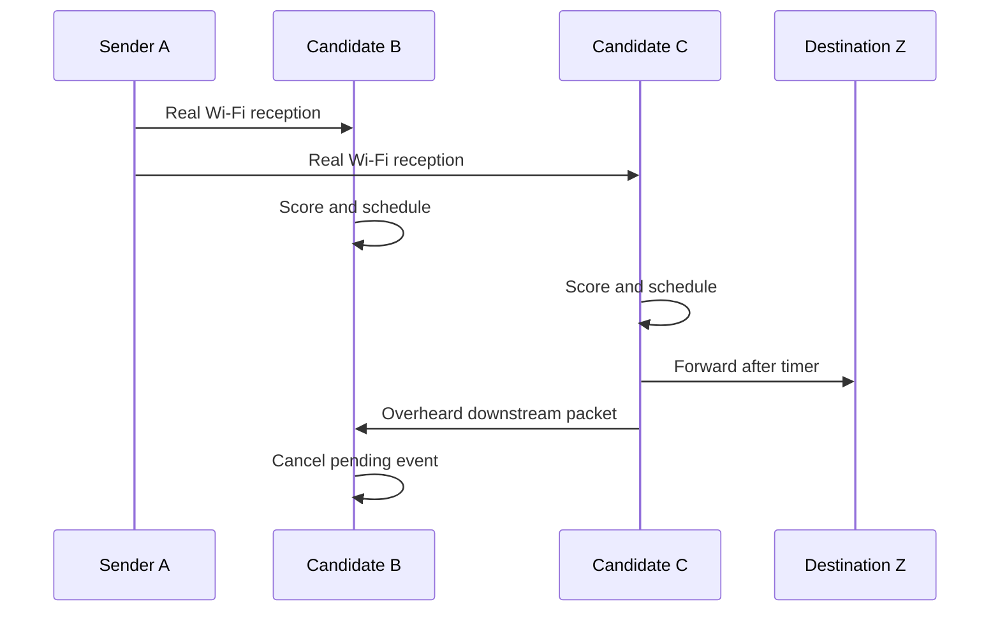

# Architecture

Reception arrows describe possible recorded events, not guaranteed channel delivery.
Trace collection is global only for offline measurement; the forwarding app never reads
another app's state or a future trace. The fixed baseline alone receives initial BFS tables.
